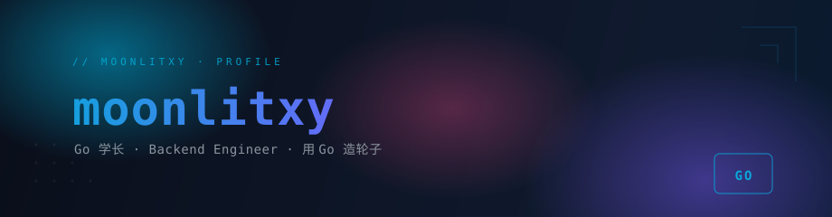
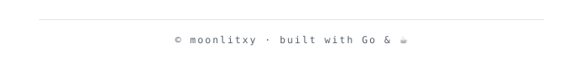

  

 

<!-- 极简项目列表：纯文字链接，不用卡片 -->

**Projects**

[`xTools`](https://github.com/moonlitxy/xTools) — Golang 工具包
[`Termix`](https://github.com/moonlitxy/Termix) — 开发连接工具
[`Blog_gin`](https://github.com/moonlitxy/Blog_gin) — gin 博客

 

**Stack**

Go · TypeScript · Python · Docker

 

  

