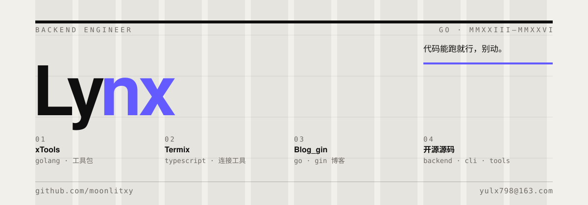

  

### 在做什么

用 Go 写后端和工具，偶尔造轮子。目前的项目都在下面。

### 索引

- **[xTools](https://github.com/moonlitxy/xTools)** — Golang 工具包
- **[Termix](https://github.com/moonlitxy/Termix)** — 开发连接工具
- **[Blog_gin](https://github.com/moonlitxy/Blog_gin)** — gin 博客

— [github.com/moonlitxy](https://github.com/moonlitxy) · [344754770@qq.com](mailto:344754770@qq.com)
